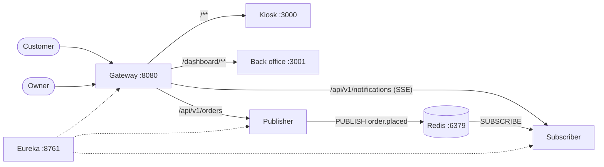

# Redis Pub/Sub — Micro Backend & Micro Frontend

> ⚠️ Educational project. Not for production.

A small order demo: the kiosk places an order, the publisher sends it to Redis, the subscriber picks it up and streams it to the back office over SSE.

## Architecture



## Structure

```
backend/        Spring Boot 4 · Java 25 · Gradle composite build
  build-logic/    convention plugins
  common/         shared domain, CORS, Eureka client
  microservices/  publisher, subscriber
  spring-cloud/   eureka, gateway
frontend/       Turborepo · Next.js 16
  apps/           web (kiosk), dashboard (back office)
  packages/       ui, tailwindcss, typescript-config, eslint-config
deployment/
  redis/          docker-compose.yaml
```

## Stack

| Backend | Frontend |
|---|---|
| Java 25, Gradle 9.7 | Node ≥ 24, npm 11 |
| Spring Boot 4.1, Spring Cloud 2025.1 | Turborepo 2.11 |
| Eureka, Gateway, Spring Data Redis | Next.js 16, React 19 |
| Redis (Docker) | Tailwind CSS 4, TypeScript |

## Getting started

**1. Redis**

```bash
docker compose -f deployment/redis/docker-compose.yaml up -d
```

**2. Backend** (from `backend/`, one terminal each, Eureka first)

```bash
./gradlew :spring-cloud:eureka:bootRun
./gradlew :spring-cloud:gateway:bootRun
./gradlew :microservices:publisher:bootRun
./gradlew :microservices:subscriber:bootRun
```

**3. Frontend** (from `frontend/`)

```bash
npm install
npm run dev
```

**4. Open**

Everything goes through the gateway.

- Kiosk: http://localhost:8080
- Back office: http://localhost:8080/dashboard
- Eureka: http://localhost:8761

## Quick test

```bash
curl -X POST http://localhost:8080/api/v1/orders \
  -H "Content-Type: application/json" \
  -d '{"customer":"Alice","products":["Graph Notebook","Enamel Mug"]}'

docker exec -it mrp-redis redis-cli SUBSCRIBE order.placed
```

## API

| Method | Path | Service |
|---|---|---|
| `POST` | `/api/v1/orders` | publisher |
| `GET` | `/api/v1/notifications/stream` | subscriber (SSE) |

## License

For educational use.